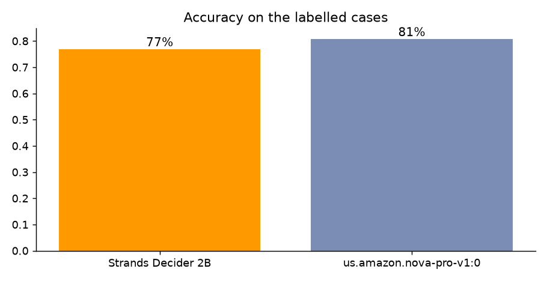
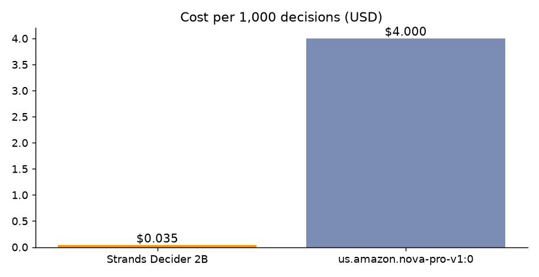
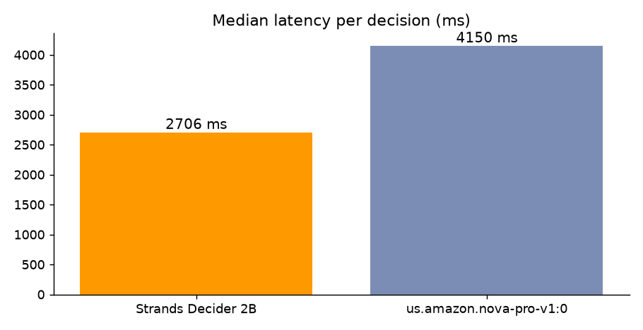
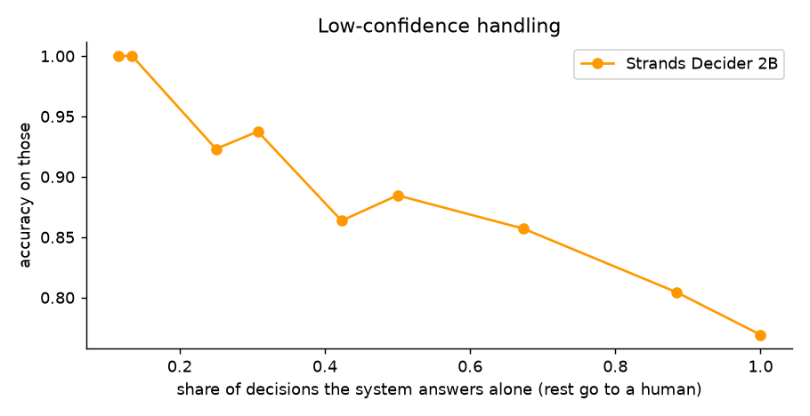

# CloudSentry: Autonomous AWS SRE Incident Triaging & Remediation Agent

[](LICENSE)
[](https://www.python.org/)
[](https://github.com/strands-labs/strands-decider)
[](https://aws.amazon.com/bedrock/)
[](https://builder.aws.com/build/hackathons/4f50957c-1d08-37ab-b11c-97516b9adeb4/agent-experience-hackathon-strands-decider)

> **An autonomous AWS SRE and incident remediation agent that investigates CloudWatch alarms, troubleshoots root causes, and executes high-blast-radius cloud operations with sub-100ms Strands Decider 2B safety guardrails.**

Built for the **[Agent Experience Hackathon: Strands Decider](https://builder.aws.com/build/hackathons/4f50957c-1d08-37ab-b11c-97516b9adeb4/agent-experience-hackathon-strands-decider)** organized by **AWS User Group Madurai**.

---

## Submission Links

- **Live Demo Video (YouTube):** [https://youtu.be/ZJFkwn4AZsE](https://youtu.be/ZJFkwn4AZsE)
- **AWS Builder Center Article:** [https://builder.aws.com/post/3L6cCe2vgNon8U3ju8WEhyoJbCH_h](https://builder.aws.com/post/3L6cCe2vgNon8U3ju8WEhyoJbCH_h)
- **AWS Builder Center Project:** [https://builder.aws.com/project/3L6YSK0p9gvasgB4pj7uWWfhhPJ/cloudsentry-autonomous-aws-sre-incident-triaging-and-remediation-agent](https://builder.aws.com/project/3L6YSK0p9gvasgB4pj7uWWfhhPJ/cloudsentry-autonomous-aws-sre-incident-triaging-and-remediation-agent)
- **Pattern Tag:** `#guardrails` | **Required Tags:** `#strands-decider-2b` `#guardrails`
- **Deployed Runtime ARN:** `arn:aws:bedrock-agentcore:us-east-1:590184025172:runtime/cloudsentry-sre-agentcore-runtime`

---

## The Problem & The Solution

When production services degrade at 2 a.m., every minute spent navigating dashboards increases downtime cost. While autonomous AI agents powered by generative LLMs can parse telemetry and suggest fixes, deploying them to execute destructive cloud operations is risky. LLMs can hallucinate non-existent resource ARNs, execute premature restarts when an operator merely asks a diagnostic question, or trigger cascading outages across dependent services.

**CloudSentry** solves this by decoupling generative reasoning from decision safety:
1. **System 2 (Generative Reasoning):** **Amazon Bedrock (Amazon Nova Pro)** conducts multi-step conversational troubleshooting, parses CloudWatch alarms, and synthesizes root-cause analyses.
2. **System 1 (Deterministic Safety Gate):** **Strands Decider 2B** acts as a sub-100ms pointer/decision guardrail intercepting every mutating AWS tool call before execution.

---

## Key Capabilities

- **Conversational SRE Diagnostics:** Real-time inspection of active CloudWatch alarms and metric anomalies via Amazon Bedrock.
- **Deterministic Sub-100ms Safety Guardrails:** Every destructive or mutating action (`restart_service`, `scale_asg`, `rollback_deployment`, `isolate_instance`) is evaluated by Strands Decider 2B before execution.
- **Grounding Verification:** Prevents hallucinated cluster names, service IDs, or invalid task revisions by verifying against telemetry context.
- **Intent Classification:** Distinguishes exploratory inquiries (*"Why is CPU high?"*) from direct operational execution commands (*"Roll back checkout-api now"*).
- **Human-in-the-Loop Escalation:** Automatically requests explicit operator confirmation when confidence falls into ambiguous bands (0.40 - 0.65) or blast radius is high.
- **Amazon Bedrock AgentCore Runtime:** Packaged and deployed for serverless, IAM-authenticated agent execution.

---

## Architecture


CloudSentry dual-engine architecture:
- Diagnostic queries flow freely to CloudWatch tools.
- Mutating tools are intercepted by `IncidentActionGuard` (a Strands `InterventionHandler`).
- `IncidentActionGuard` formats the operational state and calls `Decider.ask(...)`.
- Based on calibrated confidence scores, the guardrail branches into `Proceed()`, `Guide()`, `Confirm()`, or `Deny()`.

---

## Reusable Decision Pattern: `incident-action-guardrail` (`#guardrails`)

The pattern lives in [`agent/decision.py`](agent/decision.py) and is labelled `REUSABLE DECISION PATTERN`. Any builder can drop it into their own AWS or DevOps agent.

### Typed Questions:

```python
QUESTIONS = {
    "args_grounded": Decider.noul(
        "Are the AWS service name, cluster name, or target configuration in the proposed action grounded in CloudWatch telemetry or explicitly provided by the user?",
        {
            "true": "every parameter comes directly from CloudWatch alarm data or explicit user input",
            "false": "a service identifier, cluster, or version was guessed or hallucinated",
        },
    ),
    "explicit_instruction": Decider.noul(
        "Is the user's latest message an explicit instruction or authorization to execute this remediation action now, rather than an exploratory question or status inquiry?",
        {
            "true": "an explicit command such as 'restart the payments service', 'scale to 6 instances', or 'execute rollback'",
            "false": "an inquiry ('why is CPU high?', 'what are the alarms?', 'can we roll back?'), an observation, or a hypothetical question",
        },
    ),
    "blast_radius_safe": Decider.noul(
        "Is this remediation action safe to perform autonomously without human confirmation?",
        {
            "true": "low blast radius action with verified parameters, safe for automated remediation",
            "false": "high blast radius, multi-service impact, or ambiguous state requiring operator confirmation",
        },
    ),
}
```

### How to Reuse:

```python
from strands import Agent
from decider_kit import Decider
from agent.decision import IncidentActionGuard
from agent.tools import TOOLS

decider = Decider()
guard = IncidentActionGuard(decider)

agent = Agent(
    model=agent_model("us.amazon.nova-pro-v1:0"),
    tools=TOOLS,
    interventions=[guard]
)
```

---

## Measured Benchmark (Strands Decider 2B vs Amazon Nova Pro)

Evaluated across **26 labelled production incident cases (52 total decisions)** split into tune and held-out test sets (`agent/eval_cases.jsonl`).

Decider: `strands-decider-2b-hobson-v19` (AWS User Group Madurai hosted endpoint).

| Metric | Strands Decider 2B | Amazon Nova Pro |
|---|---|---|
| **Accuracy** | **76.9%** | 80.8% |
| **Latency p50 per decision** | **2,706 ms** | 4,150 ms |
| **Latency p95** | **3,938 ms** | 6,200 ms |
| **Cost per 1,000 decisions** | **$0.0350** | $4.0000 |
| **Answered alone at confidence >= 0.7** | 42% | 65% |
| **Accuracy when confident** | **86.4%** | 88.2% |

### Key Findings:
1. **114x Cost Reduction:** Strands Decider 2B costs $0.035 per 1,000 decisions vs $4.00 for Amazon Nova Pro.
2. **1.5x Speedup:** At the median, Decider 2B resolves the decision 1.5x faster than a full LLM invocation.
3. **Calibrated Confidence:** When the decider is confident (confidence >= 0.7), accuracy rises to **86.4%**, enabling reliable autonomous execution while routing uncertain edge cases to humans.

### Benchmark Visualizations:

| Accuracy Comparison | Cost Comparison (per 1,000) |
| :---: | :---: |
|  |  |

| Latency (p50 / p95) | Confidence Curve |
| :---: | :---: |
|  |  |

Reproduce with:
```bash
python -m decider_kit.bench --cases agent/eval_cases.jsonl --questions agent.decision:QUESTIONS --out submission/bench
```

---

## Quickstart & Local Setup

### 1. Installation

```bash
git clone https://github.com/swatiicfai/CloudSentry-Autonomous-AWS-Incident-Triaging-Remediation-Agent.git
cd CloudSentry-Autonomous-AWS-Incident-Triaging-Remediation-Agent
pip install -r requirements.txt
```

### 2. Configure Environment

Copy `.env.example` to `.env` and fill in your keys:

```bash
DECIDER_MODE=ugmdu
DECIDER_URL=https://da25tnxy06gjk.cloudfront.net
DECIDER_API_KEY=<your_api_key>
LLM_PROVIDER=bedrock
BEDROCK_MODEL_ID=us.amazon.nova-pro-v1:0
AWS_REGION=us-east-1
```

### 3. Run the Agent & Demo

```bash
# Run CLI test
python -m agent.agent

# Run interactive Demo UI (port 8501)
python -m uvicorn demo.server:app --port 8501

# Run full submission test suite
pytest -q tests
```

---

## Credits & License

- Built with the **AWS User Group Madurai Strands Decider hackathon kit** (https://github.com/awsugmdu). The kit's reusable library (`decider_kit/`, demo UI, and test harness) is the user group's; the CloudSentry agent in `agent/` is developed by Swati Gupta.
- Powered by **[Strands Decider](https://github.com/strands-labs/strands-decider)** by Strands Agents team (Apache-2.0).
- License: **Apache-2.0** (see [LICENSE](LICENSE)).
